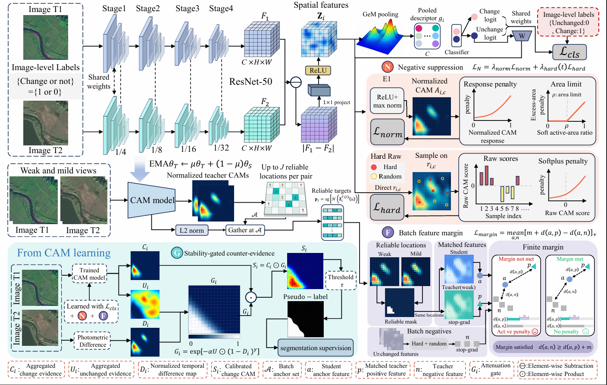

# NEC-CD: Negative-Evidence Calibration for Weakly Supervised Remote Sensing Change Detection

## News 📢

- The source code is currently **not publicly available**. It can be provided to reviewers for verification during the peer-review process upon request.
- The datasets used in our experiments and the corresponding experimental checkpoints are planned to be released in a future update.

## Overview ✨

- [News 📢](#news-)
- [Introduction 📄](#introduction-)
- [Framework Overview 🧩](#framework-overview-)
- [Datasets 🗂️](#datasets-️)
- [Experimental Setting ⚙️](#experimental-setting-️)
- [Installation 🛠️](#installation-️)
- [Training 🏋️](#training-️)
- [Inference 🧪](#inference-)
- [Code, Data and Checkpoints ⬇️](#code-data-and-checkpoints-️)
- [License 🔑](#license-)
- [Citation 📚](#citation-)

## Introduction 📄

Remote sensing change detection aims to identify changes of interest from bi-temporal images and supports a wide range of applications, such as land-cover monitoring, urban development analysis, and disaster assessment. Although deep learning has substantially advanced this task, pixel-level annotations remain costly to obtain. Image-level weakly supervised change detection reduces annotation requirements by using only image-level labels indicating whether a bi-temporal image pair contains changes.

However, image-level classification provides insufficient spatial constraints for accurate change localization. As a result, local background variations may produce false change activations even when the image-level prediction is correct. These unreliable responses can undermine change localization and the quality of pseudo-labels generated for subsequent training.

An important property of image-level supervision is its asymmetry: a changed label indicates that at least one change exists somewhere in an image pair, whereas an unchanged label verifies the absence of target changes throughout the pair. Motivated by this observation, we propose **NEC-CD**, a reliability-aware framework for negative-evidence learning and calibration in image-level weakly supervised remote sensing change detection.

During training, NEC-CD exploits verified negatives from unchanged image pairs to constrain normalized change activations and sampled raw change scores, suppressing unreliable responses at both relative and absolute levels. To extend reliable negative supervision into feature space, an exponential moving average (EMA) teacher selects high-confidence, cross-view-consistent change anchors. The student features are encouraged to approach the corresponding same-location teacher targets while remaining separated from features extracted from unchanged pairs.

At inference, predicted unchanged-class responses within changed pairs are treated as **uncertain counter-evidence**, rather than verified negatives. Their suppressive effect is modulated by a training-free photometric consistency prior that measures local bitemporal appearance stability. The calibrated change scores are then thresholded under image-level label constraints to generate pixel-level pseudo-labels without manual pixel-level annotations.

Experiments on six public benchmarks—**CLCD, Hi-CNA, JLYHCD, WHU-CD, GVLM, and GZ-CD**—demonstrate the effectiveness of NEC-CD and its state-of-the-art performance in image-level weakly supervised change detection.

## Framework Overview 🧩

The overall framework of NEC-CD is illustrated below.

  

  <em>Overall framework of NEC-CD.</em>

## Datasets 🗂️

We evaluate NEC-CD on six publicly available remote sensing change detection datasets:

| Dataset | Dataset type | Usage in this work |
| --- | --- | --- |
| CLCD | Remote sensing change detection | Image-level weakly supervised setting |
| Hi-CNA | Remote sensing change detection | Image-level weakly supervised setting |
| JLYHCD | Remote sensing change detection | Image-level weakly supervised setting |
| WHU-CD | Remote sensing change detection | Image-level weakly supervised setting |
| GVLM | Remote sensing change detection | Image-level weakly supervised setting |
| GZ-CD | Remote sensing change detection | Image-level weakly supervised setting |

**Note:** These are conventional remote sensing change detection datasets. They are **not datasets specifically constructed for image-level weakly supervised change detection**. In this work, they are used to evaluate NEC-CD under an image-level weakly supervised setting. Dataset download links, preprocessing details, and data organization are temporarily unavailable and will be added in a future update.

## Experimental Setting ⚙️

NEC-CD is implemented in **PyTorch** and trained on a single **NVIDIA RTX 4090 GPU**. An **ImageNet-pretrained ResNet-50** serves as the shared bi-temporal backbone.

### First-stage training

| Configuration | Value |
| --- | --- |
| Backbone | ImageNet-pretrained ResNet-50 |
| GPU | 1 × NVIDIA RTX 4090 |
| Training epochs | 5 |
| Batch size | 16 |
| Initial learning rate | 5 × 10⁻³ |
| Learning-rate schedule | Polynomial decay |
| Polynomial power | 0.9 |

### Second-stage training and baseline comparison

Calibrated first-stage scores are used to generate pseudo-labels for second-stage supervision. For controlled comparisons among two-stage methods, NEC-CD and the reproduced two-stage baselines use the same ResNet-50-based second-stage detector, with a batch size of **8**. Each method is trained using its own generated pseudo-labels.

End-to-end methods follow their respective training protocols and do not use pseudo-label-based second-stage training.

Other implementation details, including software dependency versions and complete training configurations, are temporarily unavailable and will be provided when the code is released.

## Installation 🛠️

**Temporarily unavailable.** The source code and dependency files have not been publicly released. Installation instructions will be added in a future update.

## Training 🏋️

**Temporarily unavailable.** Training scripts and detailed commands will be provided when the source code is released. The experimental settings currently available are summarized in the [Experimental Setting](#experimental-setting-️) section.

## Inference 🧪

**Temporarily unavailable.** Inference scripts, pretrained model loading instructions, and evaluation commands will be provided in a future update.

## Code, Data and Checkpoints ⬇️

- **Source code:** Not publicly available at the current stage. It can be provided to reviewers for verification during the peer-review process upon request.
- **Datasets:** The six datasets used in our experiments are conventional public remote sensing change detection datasets. Dataset links and the exact experimental data organization will be added in a future update.
- **Checkpoints:** Experimental weights will be released in a future update.

## License 🔑

**Temporarily unavailable.** The license will be specified when the source code is publicly released. Until then, this repository provides project and method information only.

## Citation 📚

The citation information and BibTeX entry are **temporarily unavailable**. They will be added when the paper's public preprint or publication details become available.
